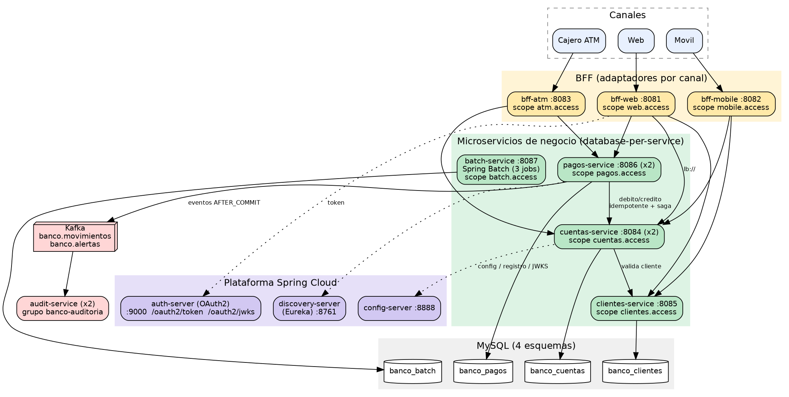

# Banco XYZ - Modernizacion Backend (EFT Semana 9) - Desarrollo Backend III

> **Repositorio GitHub:** `https://github.com/AntonioMunozDuoc/EFT_Backend_III.git`
> **Autor:** Antonio Munoz - Asignatura PBY2203 Desarrollo Backend III

Migracion del sistema legacy del Banco XYZ (COBOL + Shell sobre mainframe) a una arquitectura de
**microservicios con Spring Cloud**, **procesos batch con Spring Batch**, **BFF por canal**,
**seguridad OAuth2**, **resiliencia con Resilience4j** y **mensajeria con Kafka**, todo orquestado con Docker Compose.

## Que cambia respecto de la entrega anterior (Exp3)

La retroalimentacion pedia **microservicios de negocio independientes** y dejar a los BFF en su rol de adaptadores.
Por eso el antiguo `bank-core-api` (un unico servicio con cuentas + movimientos) se **dividio en tres
microservicios autonomos**, cada uno con su propia base de datos:

| Microservicio | Responsabilidad (capacidad de negocio) | BD propia | Puerto |
|---|---|---|---|
| `clientes-service` | Informacion personal y perfiles de clientes | `banco_clientes` | 8085 |
| `cuentas-service` | Apertura, cierre y mantenimiento de cuentas + libro de movimientos | `banco_cuentas` | 8084 (x2) |
| `pagos-service` | Pagos, transferencias, depositos y retiros (saga + eventos) | `banco_pagos` | 8086 (x2) |
| `batch-service` | Procesos batch migrados (3 jobs Spring Batch) | `banco_batch` | 8087 |

Los **BFF** (`bff-web`, `bff-mobile`, `bff-atm`) solo adaptan respuestas por canal y consumen los microservicios
por Eureka con balanceo de carga. Los microservicios **no se llaman a traves de BFF**: se hablan directamente
(`pagos -> cuentas`, `cuentas -> clientes`) con OAuth2 servicio-a-servicio.

## Arquitectura



| Modulo | Rol |
|---|---|
| `bank-common` | Libreria **tecnica** transversal (formato de error, Resilient wrapper, cliente de tokens, contrato de eventos). Sin logica de negocio |
| `config-server` | Spring Cloud Config: configuracion centralizada (`config-repo/`) |
| `discovery-server` | Eureka: descubrimiento dinamico de servicios |
| `auth-server` | Authorization Server OAuth2 (`/oauth2/token`, `/oauth2/jwks`), un scope por microservicio |
| `clientes-service`, `cuentas-service`, `pagos-service` | Microservicios de negocio |
| `batch-service` | Spring Batch (reporte diario, intereses mensuales, estados de cuenta anuales) |
| `bff-web`, `bff-mobile`, `bff-atm` | Backend for Frontend por canal |
| `audit-service` | Consumidor Kafka (movimientos y alertas de seguridad), idempotente |

## Cumplimiento de la pauta

| Requerimiento | Donde |
|---|---|
| Parte 1 - 3 jobs Spring Batch (read/process/write, retry, skip, paralelismo, restart) | `batch-service/.../job/JobsConfig.java`, `BatchLauncherService.java` |
| Parte 2 - 3 BFF con auth por canal y HTTPS/tokens | `bff-web`, `bff-mobile`, `bff-atm` (scopes `web/mobile/atm.access`, `server.ssl.*`) |
| Parte 3 - 3 microservicios | `clientes-service`, `cuentas-service`, `pagos-service` |
| Spring Cloud Config / Eureka / balanceo | `config-repo/`, `discovery-server`, `@LoadBalanced RestClient` (`http://cuentas-service`) |
| OAuth2 + Resilience4j + fallbacks | `auth-server`, `SecurityConfig` de cada servicio, `ResilientCall` + `CircuitBreaker` (ver informe) |
| Kafka productores/consumidores | `pagos-service/.../KafkaEventPublisher`, `audit-service` (topicos `banco.movimientos`, `banco.alertas`) |
| Docker Compose + escalado horizontal | `docker-compose.yaml` (`cuentas-service` y `pagos-service` con 2 replicas) |

## Inicio rapido

```bash
cp .env.example .env            # opcional
docker compose up -d --build    # levanta toda la plataforma
bash scripts/smoke-test.sh      # prueba de extremo a extremo
```

Mas detalle: [`instrucciones.md`](instrucciones.md) (ejecutar y probar) y [`despliegue.md`](despliegue.md) (nube AWS).
Informe tecnico: `Informe_Tecnico_EFT_Antonio_Munoz.pdf`. Guion del video: [`docs/guion-video.md`](docs/guion-video.md).

## Datos de entrada del batch

CSV del repositorio `KariVillagran/fin_legacy_data` (carpetas `semana_1` y `semana_3`) incluidos en
`batch-service/src/main/resources/data/`. Los defectos intencionales (fechas en 4 formatos, montos vacios o
negativos, tipos invalidos, duplicados, edades fuera de rango) se gestionan con politicas de **skip/retry**.
